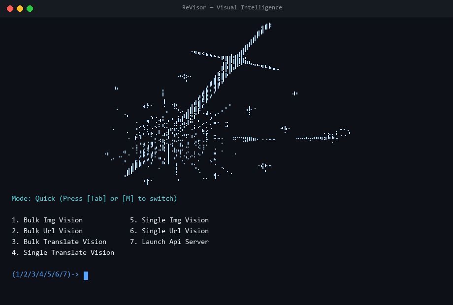

<div align="center">


<p>
  
  
  
  
  
</p>

<br />



</div>

---

## Why ReVisor?

**ReVisor** (**Visor**) delivers ultra-fast OCR extraction, in-place image & text translation, visual entity recognition, and contextual overview synthesis in one lightweight, unlimited-use, purely request-based package — **zero browser automation, zero heavy runtimes.**

<table>
  <tr>
    <td width="50%">
      <h3>⚡ Quick Mode (<code>-f</code>, Default)</h3>
      <ul>
        <li>Sub-second OCR, entity recognition & concise summary</li>
        <li>Built for high-volume CLI runs, batch jobs & APIs</li>
      </ul>
    </td>
    <td width="50%">
      <h3>🧠 Detailed Mode (<code>-d</code>)</h3>
      <ul>
        <li>Deeper multi-region visual inspection & higher detail</li>
        <li>Extended encyclopedic overview synthesis & metadata</li>
      </ul>
    </td>
  </tr>
  <tr>
    <td width="50%">
      <h3>🌐 Text & Image Translation (<code>-t</code>)</h3>
      <ul>
        <li>Understands shortcuts (<code>es</code>, <code>fr</code>, <code>ja</code>) & full names (<code>Spanish</code>, <code>Japanese</code>)</li>
        <li>Saves clean <code>beforeN.png</code> + <code>resultN.png</code> pairs & <code>results.txt</code> in <code>results/</code></li>
      </ul>
    </td>
    <td width="50%">
      <h3>🎛️ Live UI & Zero-Config <code>.exe</code></h3>
      <ul>
        <li>Press <code>Tab</code> or <code>M</code> in the interactive menu to switch <code>Quick</code> ↔ <code>Detailed</code> instantly</li>
        <li>Standalone <code>revisor.exe</code> prepares the runtime automatically</li>
      </ul>
    </td>
  </tr>
</table>

---

## Quick Start

### Option 1 — Standalone Windows Executable (`revisor.exe`)

```bash
revisor.exe                              # Interactive UI (press Tab or M to switch modes)
revisor.exe img/test.png                 # Quick OCR + Overview
revisor.exe img/test2.png -d             # Detailed deep visual analysis
revisor.exe img/test2.png -t Spanish     # Translate & save before/after images + results.txt
revisor.exe img/test2.png -t es -tt      # Text translation only -> results/results.txt
revisor.exe img/test2.png -t fr -ti      # Image translation only -> results/beforeN.png & resultN.png
revisor.exe img/test.png --json          # Machine-readable JSON output
revisor.exe --api                        # Start REST API server on port 8000
```

### Option 2 — Python CLI

```bash
python revisor.py img/test.png
python revisor.py img/test2.png -d
python revisor.py img/test2.png -t Japanese
python revisor.py img/test2.png -t es -to translated_image.png -y
python revisor.py img/ -y
python revisor.py img/ -t French -y
python revisor.py https://example.com/image.png -y
python revisor.py urls.txt -y
python revisor.py --api
```

### Interactive Terminal Menu

Press **`Tab`** or **`M`** anytime on the main menu to toggle **`Mode: Quick`** ↔ **`Mode: Detailed`** immediately:

```text
1. Bulk Img Vision
2. Bulk Url Vision
3. Bulk Translate Vision       -> 1. Text Translation / 2. Image Translation
4. Single Translate Vision     -> 1. Text Translation / 2. Image Translation
5. Single Img Vision
6. Single Url Vision
7. Launch Api Server
```

---

<details>
<summary><b>📡 REST API Endpoints & Python SDK</b></summary>

<br />

Start the server with `python api.py` or `revisor.exe --api`:

| Method | Endpoint | Description |
| :--- | :--- | :--- |
| `GET` | `/` | Service status, supported modes & capabilities |
| `GET` | `/health` | Health check endpoint |
| `POST` | `/search/image` | Analyze uploaded image (`target_lang`, `mode=quick\|detailed`) |
| `POST` | `/search/url` | Analyze public image or webpage URL (`url`, `target_lang`, `mode`) |
| `POST` | `/bulk/image` | Concurrent batch image analysis |
| `POST` | `/bulk/url` | Concurrent batch URL analysis |
| `POST` | `/bulk/url/file` | Concurrent batch URL analysis from uploaded file |
| `POST` | `/task/create` | Create asynchronous analysis job |
| `GET` | `/task/{task_id}` | Poll asynchronous job status & result |

```python
import asyncio
from revisor import ReVisor

async def main():
    async with ReVisor() as client:
        result = await client.search("img/test2.png", target_lang="Spanish", mode="detailed")
        print("Mode:", result.get("mode"))
        print("OCR:", result.get("ocr_text"))
        print("Translated:", result.get("translated_text"))
        print("Overview:", result.get("ai_overview"))

asyncio.run(main())
```

</details>

---

## Community & Support

- **Discord Server**: https://discord.gg/PYfeSaDGPJ
- **Contact**: [@sqnq](https://discord.com/users/987979957907116052)

### Buy Me A Coffee ☕

**Litecoin (LTC)** — click copy on the right:

```text
LbDG5BE3foVsfK6JRsSc7UtBVX4DqYYKXN
```

<div align="center">

**Made With ♥️ By [Tej](https://github.com/tejzv)**


</div>
